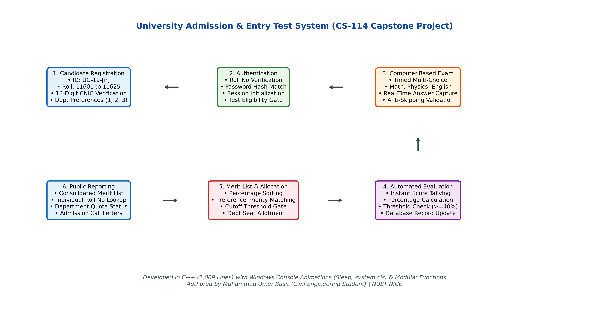
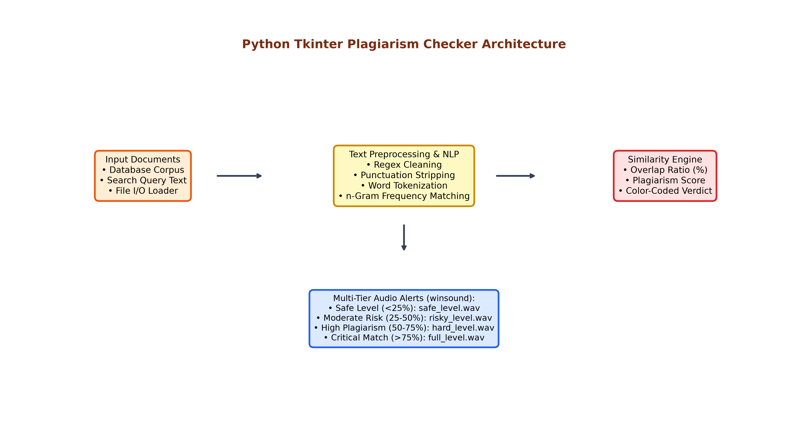
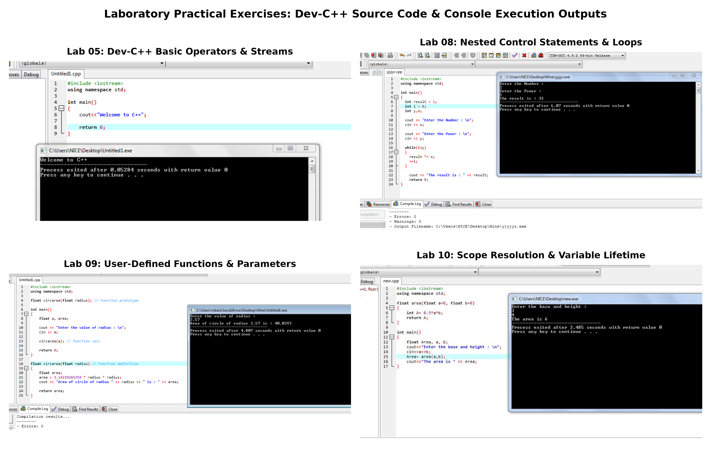
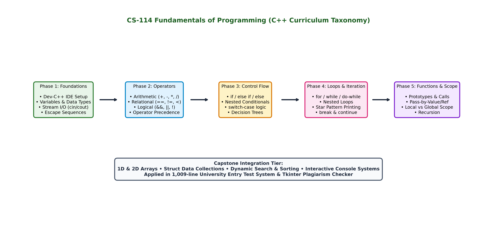

# Programming Fundamentals & Computer Science Applications (C++ & Python)

[](https://isocpp.org/)
[](https://www.python.org/)
[](#curriculum-roadmap--courseware)
[](https://nust.edu.pk/)
[](LICENSE)

An academic and practical repository for **CS-114: Fundamentals of Computer Programming & Information and Communication Technologies (ICT)**, completed during Semester 1 at the National University of Sciences and Technology (NUST).

Authored by **Muhammad Umer Basit (Civil Engineering Student)**.

---

## Repository Structure

```
Programming-Fundamentals-CPP-ICT/
├── term-project-entry-test-system/     # 1,009-line C++ University Admission & Exam System + Python CLI
├── audio-library-database/             # C Structured Track Database Manager + Python Runner
├── python-plagiarism-checker/          # Python Tkinter GUI Plagiarism Detection Application
├── lab-tasks-and-exercises/            # Lab practicals (Labs 03 to 11) with C++ code & screenshots
│   ├── lab-03-office-productivity/     # PowerPoint & office workflow tasks
│   ├── lab-05-devcpp-basics/           # Variables, arithmetic operators & stream I/O (15 tasks)
│   ├── lab-08-control-structures/      # Conditionals, loops & nested star patterns (6 tasks)
│   ├── lab-09-functions-part-1/        # User-defined functions, circle area, distance & abs val
│   ├── lab-10-functions-part-2/        # Scope resolution, variable lifetime & pass-by-reference
│   └── lab-11-arrays/                  # 1D & 2D array data structures manual
├── algorithm-and-pseudo-code/          # Step-by-step algorithm design & flowchart logic
├── lectures-and-courseware/            # 14-lecture slide curriculum, exam papers, quizzes, textbook
├── scripts/                            # Visual generators & docx media extraction tools
└── media/                              # 300 DPI high-res architecture diagrams, roadmaps, and lab grids
```

---

## 1. Capstone Project: University Admission & Entry Test System (C++)

The primary term project for CS-114 is a complete **Computer-Based University Admission, Examination, and Merit Allocation System** authored in modular C++ (`Project_ict.cpp`, 1,009 lines of code). Presented on December 17, 2018 at NUST NICE.


*Figure 1: End-to-end operational architecture of the University Admission & Entry Test System.*

### Architectural Highlights & Features
1. **Candidate Registration:**
   - Automated generation of unique Student IDs (`UG-19-1` to `UG-19-25`) and sequential Examination Roll Numbers (`11601` to `11625`).
   - Strict input validation enforcing 13-digit Pakistani National Identity Card (CNIC) formatting without symbols.
   - Multi-choice department preference prioritization (Choice 1, Choice 2, Choice 3 across Civil, Electrical, Mechanical, and Software Engineering).
2. **Secure Authentication & Eligibility Gate:**
   - Candidate login verification via assigned Roll Number and case-sensitive password.
   - Prevents duplicate exam attempts through session state tracking.
3. **Computer-Based Examination Engine:**
   - Timed multiple-choice testing across Mathematics, Physics, Chemistry, and English.
   - Console animations powered by Windows API (`windows.h`: `Sleep()`, `system("cls")`).
   - Anti-skipping input validation for clean stream buffer handling.
4. **Merit Computation & Department Allocation:**
   - Real-time score tallying, percentage calculation, and automated ranking.
   - Intelligent seat allotment matching candidate merit against department cutoff thresholds:
     - **$\ge 80\%$:** Allotted First Department Preference.
     - **$\ge 60\%$:** Allotted Second Department Preference.
     - **$\ge 40\%$:** Allotted Third Department Preference.
     - **$< 40\%$:** Disqualified (Below university admission criteria).
5. **Public Inquiries & Reporting:**
   - Consolidated public merit list display with ranked standings.
   - Individual scorecard lookup by examination roll number.

A modern, cross-platform Python CLI simulation is included in [university_admission_system.py](term-project-entry-test-system/university_admission_system.py).

---

## 2. Python Tkinter GUI Plagiarism Detection Tool

A standalone desktop application designed in Python using Tkinter for graphical interface rendering and natural language processing (NLP) heuristics for document comparison.


*Figure 2: Architectural pipeline of the Python Tkinter Plagiarism Detector.*

### Core Capabilities
- **Dual-Pane Interface:** Simultaneous loading and visual side-by-side inspection of source corpus (`database.txt`) and target query text (`search.txt`).
- **Text Preprocessing:** Regular expression filtering, lowercasing, punctuation normalization, and whitespace stripping.
- **Similarity Scoring:** Token-level overlap and n-gram comparison generating an accurate match percentage ($0\%\text{--}100\%$).
- **Multi-Tier Audio Alerts:** Integrated audio feedback utilizing Windows multimedia sound drivers (`winsound`):
  - **Safe Level ($< 25\%$):** `safe_level.wav` (Original work)
  - **Moderate Risk ($25\%\text{--}50\%$):** `risky_level.wav` (Caution warranted)
  - **High Plagiarism ($50\%\text{--}75\%$):** `hard_level.wav` (Extensive overlap)
  - **Critical Match ($> 75\%$):** `full_level.wav` (Severe duplication alert)
- **Timestamped Audit Logging:** Generates audit reports documenting similarity ratios with system date and time stamps.

Source code and assets are available in [python-plagiarism-checker/](python-plagiarism-checker/).

---

## 3. Audio & Music Track Database Management System (C)

Authored in standard C (`thing.cpp`, 350 lines), this project demonstrates structured database design, dynamic memory layout, and persistent file I/O serialization.

### Features
- **Structured Data Modeling:** Encapsulates track records via nested `struct`:
  ```c
  struct TrackInfo {
      char title[40];
      char artist[40];
      char genre[40];
      int year;
      float time;
      char fileLocation[40];
  };
  ```
- **Operations:** Interactive menu allowing track registration, editing, deletion, and alphabetical search by artist name or musical genre.
- **File Persistence:** Reads and writes structured records from disk, ensuring persistent storage between sessions.

A companion Python implementation is available in [music_library_manager.py](audio-library-database/music_library_manager.py).

---

## 4. Laboratory Practical Curriculum (Labs 03 to 11)

A systematic collection of laboratory manuals, C++ source implementations, and Dev-C++ IDE console execution screenshots.


*Figure 3: Dev-C++ source code implementations and verified console executions across lab practicals.*

### Lab Breakdown

| Lab Module | Focus Area | Technical Scope & Implemented Tasks | Documentation & Code |
|:---|:---|:---|:---|
| **Lab 03** | Office Productivity | Microsoft PowerPoint technical presentation formatting, animations, slide master layouts, and delivery. | [Lab-03 Manual](lab-tasks-and-exercises/lab-03-office-productivity/) |
| **Lab 05** | Dev-C++ Basics & I/O | C++ environment setup, fundamental data types (`int`, `float`, `double`, `char`), stream operators (`cin`, `cout`), arithmetic operations, escape sequences. | [Lab-05 Tasks & Screenshots](lab-tasks-and-exercises/lab-05-devcpp-basics/) *(15 exercises)* |
| **Lab 06** | Operators | Relational operators (`==`, `!=`, `<`, `>`), logical operators (`&&`, `\|\|`, `!`), conditional ternary operator (`?:`). | [Lab-06 Manual](lab-tasks-and-exercises/lab-08-control-structures/Lab-06-Relational-Logical-Operators-Manual.pdf) |
| **Lab 07** | Control Structures I | Sequential control flow, `if`, `if-else`, nested `if` statements, multi-way branch `switch-case` constructs. | [Lab-07 Manual](lab-tasks-and-exercises/lab-08-control-structures/Lab-07-Control-Statements-Manual.pdf) |
| **Lab 08** | Control Structures II | Iteration statements: `for` loops, `while` loops, `do-while` loops, break/continue statements, nested loops, star pyramid generators. | [Lab-08 Tasks & Screenshots](lab-tasks-and-exercises/lab-08-control-structures/) *(6 exercises)* |
| **Lab 09** | Functions Part I | Function definitions, prototypes, parameter passing, return values. Circle area calculator (`circarea`), distance comparator (`largerDistance`), absolute value function (`absolute`). | [Lab-09 C++ Code](lab-tasks-and-exercises/lab-09-functions-part-1/) |
| **Lab 10** | Functions Part II | Scope resolution (`::`), local vs global variable lifetime, pass-by-value vs pass-by-reference mechanisms. | [Lab-10 Tasks & Screenshots](lab-tasks-and-exercises/lab-10-functions-part-2/) |
| **Lab 11** | Arrays | Single-dimensional arrays, two-dimensional matrix representations, array bounds checking, sequential iteration. | [Lab-11 Manual](lab-tasks-and-exercises/lab-11-arrays/Lab-11-Arrays-Manual.docx) |

---

## 5. Curriculum Roadmap & Courseware


*Figure 4: CS-114 Programming Fundamentals progression taxonomy from basic syntax to capstone software systems.*

The [lectures-and-courseware/](lectures-and-courseware/) directory includes:
- **Course Outline:** Official NUST NICE syllabus for CS-114 (Theory: 2 credits / 32 hours, Practical: 1 credit / 48 hours).
- **14-Lecture Slides Series:**
  - `Lec-01-Introduction.pptx`: Computing fundamentals, compilers, algorithms, flowcharting.
  - `Lec-02-Program-Development-I.pptx` & `Lec-03-Program-Development-II.pptx`: Program design lifecycle, source files, linker, IDE.
  - `Lec-04-Operators-in-CPP-I.pptx` & `Lec-05-Operators-in-CPP-II.pptx`: Expressions, evaluation order, precedence tables.
  - `Lec-06-Control-Statements-I.pptx` & `Lec-07-Control-Statements-II.pptx`: Conditional branching, logic design.
  - `Lec-08-Control-Statements-III.pptx` & `Lec-09-Control-Statements-IV.pptx`: Looping paradigms, nested iteration.
  - `Lec-10-Functions-I.pptx`, `Lec-11-Functions-II.pptx`, `Lec-12-Functions-III.pptx`: Procedural programming, stack frames, call-by-reference.
  - `Lec-13-Arrays-Jump-Statements.pptx` & `Lec-14-Arrays-II.ppt`: Vectors, multidimensional matrices, array manipulation.
- **Examinations & Assessments:**
  - `OHT2-Exam-Paper-Fall2018.pdf`: One-Hour Midterm Exam 2 covering control structures and functions.
  - `Quiz-03-Solution.pptx` & `Quiz-05.pptx`: Quizzes on loops, branching, and expressions.
  - `Practice-Questions-ESE.pptx`: End Semester Exam comprehensive review set.
- **Reference Literature:**
  - *C++: The Complete Reference (4th Edition)* by Herbert Schildt (`CPP-Complete-Reference-4th-Ed.pdf`).
  - *C++ How to Program (8th Edition)* by Paul Deitel & Harvey Deitel (Cited).
  - *Introduction to Computers (6th Edition)* by Peter Norton (Cited).

---

## 6. How to Build & Run

### Prerequisites
- Any standard C++ compiler: `g++` (MinGW / GCC), MSVC (`cl`), Clang, or Dev-C++ IDE.
- Python 3.8+ (for Python simulations and GUI tools).

### 1. Compiling and Running the C++ Term Project
```bash
# Using GCC / MinGW:
g++ -O2 term-project-entry-test-system/Project_ict.cpp -o entry_test_system
./entry_test_system
```

### 2. Running the Python Admission System Simulation
```bash
python term-project-entry-test-system/university_admission_system.py
```

### 3. Running the Python Plagiarism Checker
```bash
cd python-plagiarism-checker
python plagiarism_detector.py
```

### 4. Running the C Track Database / Python Manager
```bash
# Python simulation:
python audio-library-database/music_library_manager.py

# C compilation:
gcc -O2 audio-library-database/thing.cpp -o music_manager
./music_manager
```

---

## 7. Author Attribution & Academic Integrity

- **Author:** Muhammad Umer Basit (Civil Engineering Student)
- **Institution:** Department of Civil Engineering, National Institute of Transportation (NIT), National University of Sciences and Technology (NUST), Islamabad, Pakistan
- **Course:** CS-114 Fundamentals of Computer Programming / ICT (Semester 1, Fall 2018)
- **Term Project Group Members:** Hassan Mughal (Team Lead), Haziq Ahmad, Hamas Ahmad Khan, Muhammad Umer Basit, Mahmood Mohi ud din

---

## 8. License

This repository is licensed under the [MIT License](LICENSE).
